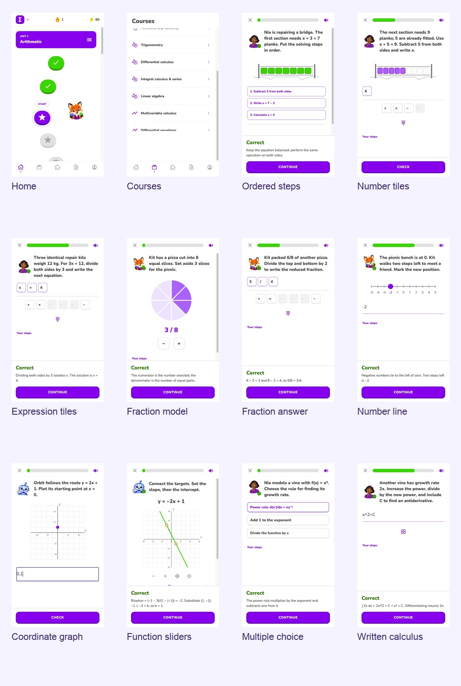

# DodoMath 🟣

Learn mathematics one clear step at a time. DodoMath is a playful Expo app with original course videos, guided exams, written answers, story puzzles, and interactive graphs.

**193 lessons · 11 course levels · 789 guided course questions · 9 question formats**

[Watch the 30-second journey](https://github.com/Up-to-code/DodoMath/releases/download/v0.1.0/dodomath-journey-30s.mp4) · [Original 3:46 recording](https://github.com/Up-to-code/DodoMath/releases/download/v0.1.0/dodomath-journey-original.mp4) · [TikTok demo](https://www.tiktok.com/@e.nsan/video/7695308435541265682)



## What you can do

- Follow a purple learning path from arithmetic to partial differential equations.
- Watch Professor Dave’s original YouTube lessons and consult the demonstrated method.
- Choose an approach, then solve intermediate steps before the final answer.
- Build removable answer tiles or write your own mathematical expression.
- Order solving steps, select fraction slices, place number-line values, and plot coordinates.
- Adjust slope/intercept and quadratic coefficients to fit graph targets.
- Get animated feedback from Fox, Nia, and Orbit, with sound and reduced-motion settings.
- Save Working nodes and track local mastery, XP, studied videos, and daily goals.

## Quick start

Install Node.js 24 (validated with 24.12.0) and pnpm 12.11.2, then:

```sh
git clone https://github.com/Up-to-code/DodoMath.git
cd DodoMath
pnpm install --frozen-lockfile
pnpm web
```

Open the local URL printed by Expo. The mathematics flow needs no account or API keys. Internet access is required for embedded YouTube videos.

For iOS/Android development builds, prerequisites and optional integrations, see [Setup](docs/setup.md).

## Question formats

| Format | Interaction |
| --- | --- |
| Choice | Choose the next method or operation. |
| Number | Build or type a numeric answer. |
| Fraction | Enter a fraction, including reduced forms when requested. |
| Expression | Build or write an equation or symbolic expression. |
| Ordered steps | Arrange a method in its required sequence. |
| Fraction model | Select equal slices of a fraction circle. |
| Number line | Place a positive or negative value. |
| Coordinate graph | Plot a point or enter its coordinates. |
| Function graph | Adjust linear or quadratic coefficients using sliders or inputs. |

## Documentation

- [Setup and troubleshooting](docs/setup.md)
- [Architecture and navigation](docs/architecture.md)
- [Course authoring, grading, and validation](docs/content.md)
- [Contributing](CONTRIBUTING.md)
- [Credits and asset terms](CREDITS.md)
- [Detailed development notes](docs/development-notes.md)

## Checks

```sh
pnpm typecheck
pnpm lint
node tests/answerValidation.test.cjs
node tests/courseExams.test.cjs
node tests/functionGraph.test.cjs
```

These checks passed for this preview. The authored advanced course calculations also have 554 independent SymPy checks. Native JavaScript exports were checked; physical-device playback, gestures, and haptics still need testing.

## Preview status

Progress is stored locally; account syncing is not implemented. Graph exercises currently support linear and quadratic polynomials. Advanced grading is conservative and may reject valid identities it cannot prove. Course exercises use original examples grounded in source-caption method review; they are not exact copies of every on-screen problem. Independent teaching review remains needed.

Adapted from [Adrian Hajdin’s React Native Lingua starter](https://github.com/adrianhajdin/react-native-lingua), using [Professor Dave Explains’ mathematics playlist](https://www.youtube.com/playlist?list=PLybg94GvOJ9FoGQeUMFZ4SWZsr30jlUYK). DodoMath is independent and unaffiliated with Duolingo. See [Credits](CREDITS.md) for reuse terms.

## Research-based interface refresh · 13 October 2026

The current interface follows a public-source Math study with 117 official screenshot panels, path examples, character animation research, and primary sound-design references. The full local evidence library is separate from the repository; reference art is not shipped as app assets. See [Design research](docs/design-research.md).

**Fox is the primary mascot**, with Nia and Orbit supporting mathematics practice. The cast uses generated transparent PNG poses rather than hand-built SVG characters. Four expression/gesture states crossfade on input and grading; reduced motion uses static poses. Legacy Dodo names remain only as compatibility exports/routes. This change does not rename the DodoMath application or repository.

Question screens use short instructions, speech bubbles, a central mathematical stage, compact answers, and a safe bottom Check button. The learning path has alternating winding units and bounded inline lesson details. Grading and sequential source-method practice remain intact. Current WAV feedback effects use original synthesis; see the updated provenance file.

## Project links

[Source](https://github.com/Up-to-code/DodoMath) · [Issues](https://github.com/Up-to-code/DodoMath/issues) · [Public project directory](https://github.com/qentrah/.github/blob/main/profile/PROJECTS.md)
